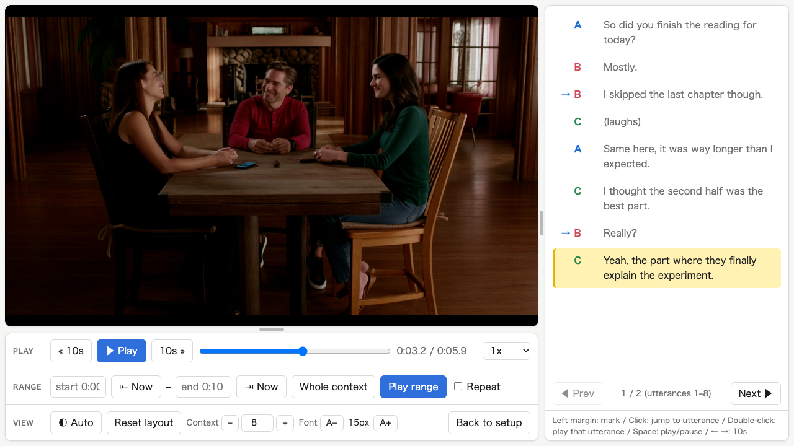
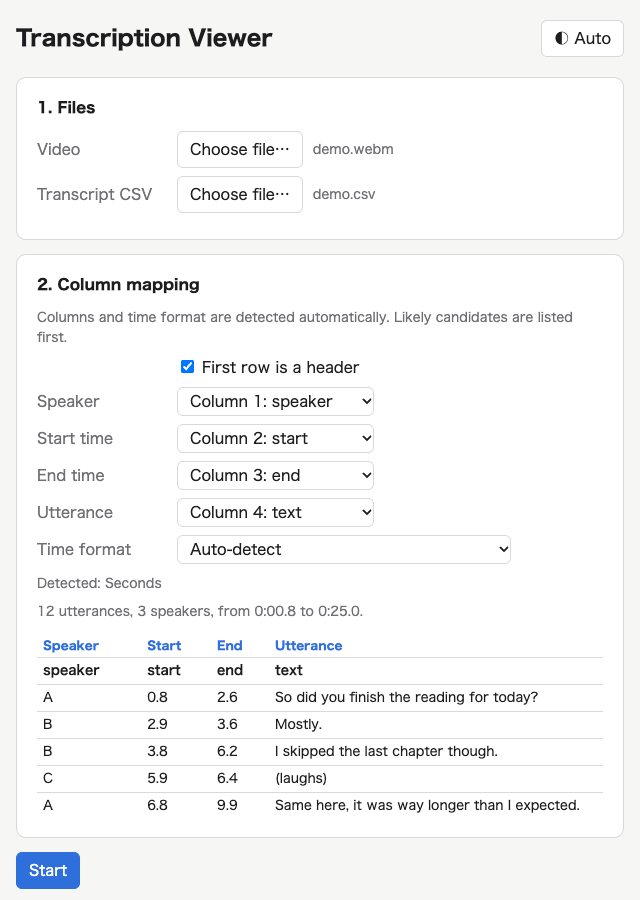

# Transcription Viewer

A single-file, browser-based viewer that plays a video side by side with its transcript and highlights the utterance being spoken right now.

No installation needed: open `transcription-viewer.html` in a browser (Chrome, Edge or Safari) on macOS or Windows.



## Quick start

1. Open `transcription-viewer.html` (double-click it).
2. Choose a video file and a transcript CSV.
3. Check the column mapping and time format (both are detected automatically) and press **Start**.



Closing the browser tab ends the session. Files are read locally and never uploaded anywhere.

## Transcript CSV

One row per utterance, with columns for **speaker**, **start time**, **end time** and **utterance text**. The column order and names don't matter.

```csv
speaker,start,end,text
A,0.8,2.6,So did you finish the reading for today?
B,2.9,3.6,Mostly.
```

- Encodings: UTF-8 (with or without BOM) and Shift_JIS
- Delimiters: comma or tab
- Time formats: seconds (`12.345`), milliseconds (`12345`), clock (`1:02.5`, `00:01:02,500`), timecode (`hh:mm:ss:ff`), or frame number (timecode and frame number need an fps value)

### Automatic detection

- **Header row:** detected from whether the first row looks like data.
- **Columns:** start and end are picked from the columns that hold times, choosing the pair where end ≥ start in most rows. The utterance column is the one with long, varied text, and the speaker column the one with a few short repeated values. Header names such as `speaker`, `start`, `end` and `text` take priority.
- **Time format:** detected from the values and checked against the video length.
- In each dropdown, the likely candidates are listed first.
- A summary below the mapping shows the number of utterances and speakers and the time span. It warns about unreadable times, rows whose end is before their start, or a transcript that runs past the end of the video.

## Viewer

- **Transcript context:** the transcript shows a fixed block of *N* utterances (the context length). When playback moves past the block, the next block replaces it. **Prev / Next** below the transcript moves between blocks. Utterances being spoken are highlighted, and those already finished are dimmed.
- **Playback:** play/pause, ±10 s, a seek bar, and playback speed.
- **Range playback:** enter a start and end time, or fill them from the current position (**Now**) or the visible block (**Whole context**). Then press **Play range**, and tick **Repeat** to loop it. With Repeat on and no range playing, the whole video loops.
- **Transcript interaction:** click an utterance to jump to it, or double-click it to play just that utterance.
- **Marking:** click the narrow margin to the left of the speaker name to mark an utterance with an arrow (→). Click it again to remove the mark. Marks are kept only while the page is open.
- **Layout:** drag the borders between the video, the control panel and the transcript to resize them. Double-click a border or press **Reset layout** to restore the default sizes.
- **Context length and font size:** adjust them in the **View** row of the control panel (defaults: 10 utterances, 15 px).
- **Theme:** Auto (follows the OS), Light or Dark.
- Layout, context length, font size and theme are remembered by the browser.

### Keyboard shortcuts

| Key | Action |
| --- | --- |
| Space | Play / pause |
| ← / → | Back / forward 10 seconds |
